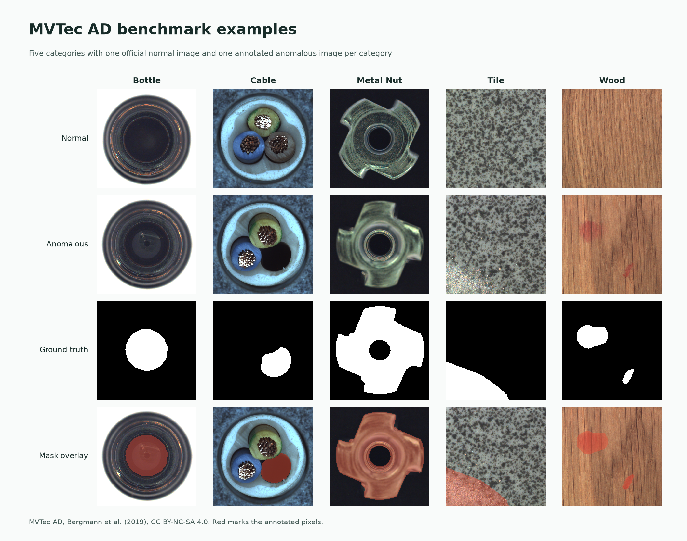
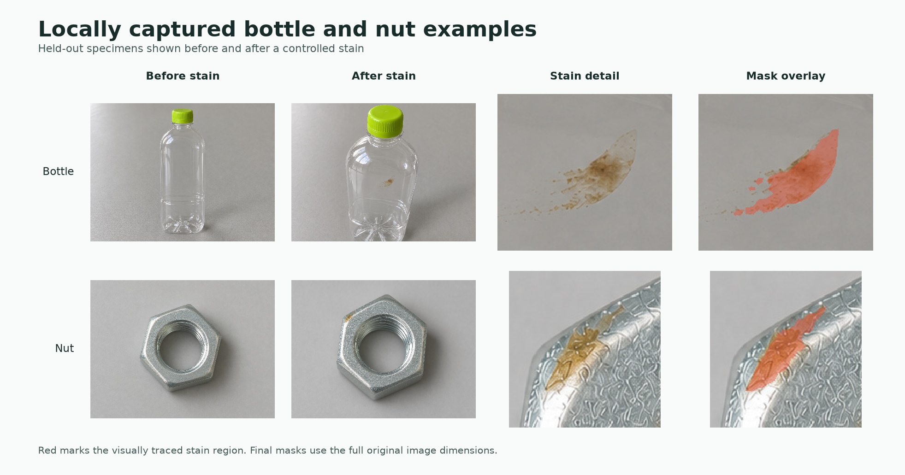

# Industrial Anomaly Detection Data and Protocol

## Motivation

Industrial visual inspection requires detecting whether an item is defective and locating the affected region. In the setting studied here, fitting uses only normal examples. We compare a convolutional autoencoder that reconstructs input images with PatchCore, which scores local features against a reference bank of normal patches. Common data splits support comparisons of defect detection, localization, and inference cost.

## MVTec AD

We use five categories from the MVTec AD benchmark, covering three object categories (bottle, cable and metal nut) and two texture categories (tile and wood). We retain the official test split for each category and hold out approximately 20% of the original normal training images for validation. The holdout is generated per category with a fixed seed of 42 and a deterministic ranking of filenames. Both methods use the same train and validation assignments. Image-level detection uses the official normal and anomalous test images, and pixel-level localization uses the supplied masks. [Bergmann et al., CVPR 2019](https://openaccess.thecvf.com/content_CVPR_2019/html/Bergmann_MVTec_AD_--_A_Comprehensive_Real-World_Dataset_for_Unsupervised_Anomaly_Detection_paper.html)

| Category | Train normal | Validation normal | Test normal | Test anomalous | Total |
| --- | ---: | ---: | ---: | ---: | ---: |
| Bottle | 167 | 42 | 20 | 63 | 292 |
| Cable | 179 | 45 | 58 | 92 | 374 |
| Metal nut | 176 | 44 | 22 | 93 | 335 |
| Tile | 184 | 46 | 33 | 84 | 347 |
| Wood | 198 | 49 | 19 | 60 | 326 |
| **Total** | **904** | **226** | **152** | **392** | **1,674** |

## Locally Captured Bottle and Nut Set

Our group contributed 160 photographs of bottles and metal nuts. The images show individual objects at several viewing angles against a neutral background. Each category contains 16 recorded physical specimens with five photographs per specimen. Eight specimens are assigned to training, three to validation, and five to independent testing. Every view of a specimen, including its before-stain and after-stain views, stays in the same split.

Training and validation use normal views. The test images include both normal and controlled-stain views. Six photos taken before the stain was applied are normal test examples. The visible regions in the 24 after-stain images were traced as polygons and rasterized into binary masks at the native photo resolution. Diffuse stain boundaries are approximate. The independent local experiment characterizes these two categories in this controlled-stain setup.

| Category | Train normal | Validation normal | Test normal | Test stained | Total |
| --- | ---: | ---: | ---: | ---: | ---: |
| Bottle | 40 | 15 | 13 | 12 | 80 |
| Nut | 40 | 15 | 13 | 12 | 80 |
| **Total** | **80** | **30** | **26** | **24** | **160** |

## 展示页讲解要点

- 用 MVTec AD 配图解释两个评测层次。图像级看整张图是否异常，像素级看异常区域能否与掩码对齐。
- 介绍主实验五类及固定划分。两种模型都用同一批正常训练图，验证阶段确定配置和阈值，正式测试集用于出结果。
- 用自采配图解释同一实物的污渍前后照片都留在测试集。自采包含两类、160 张图、24 个异常掩码，实验用自采正常图拟合后在自采测试集独立评估。
